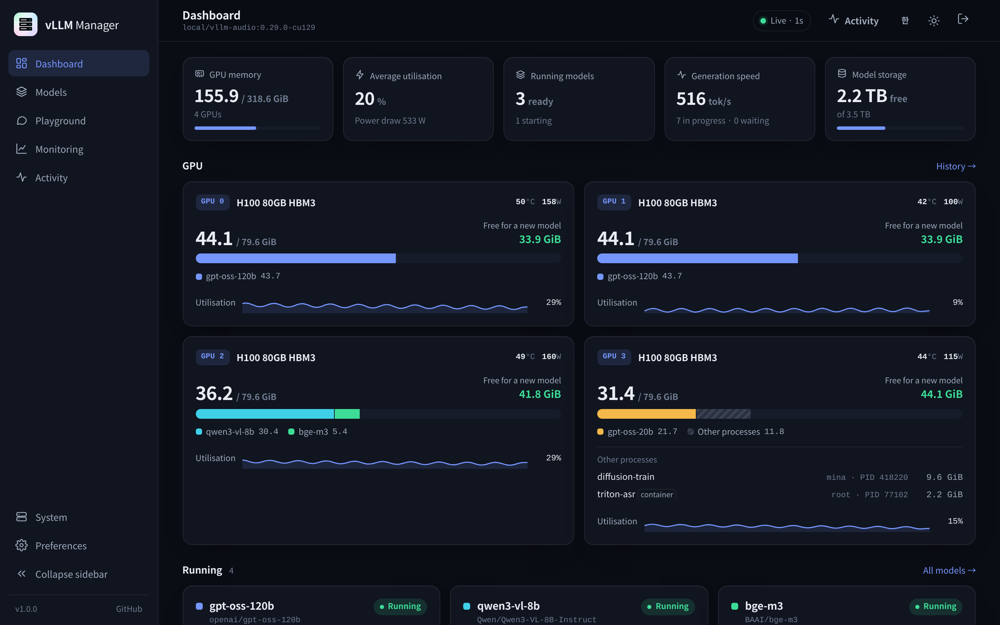
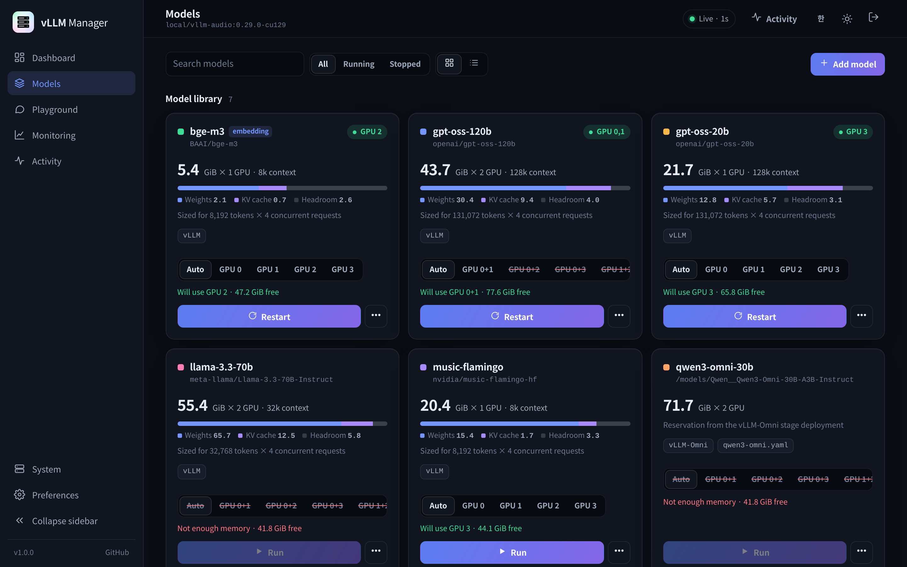
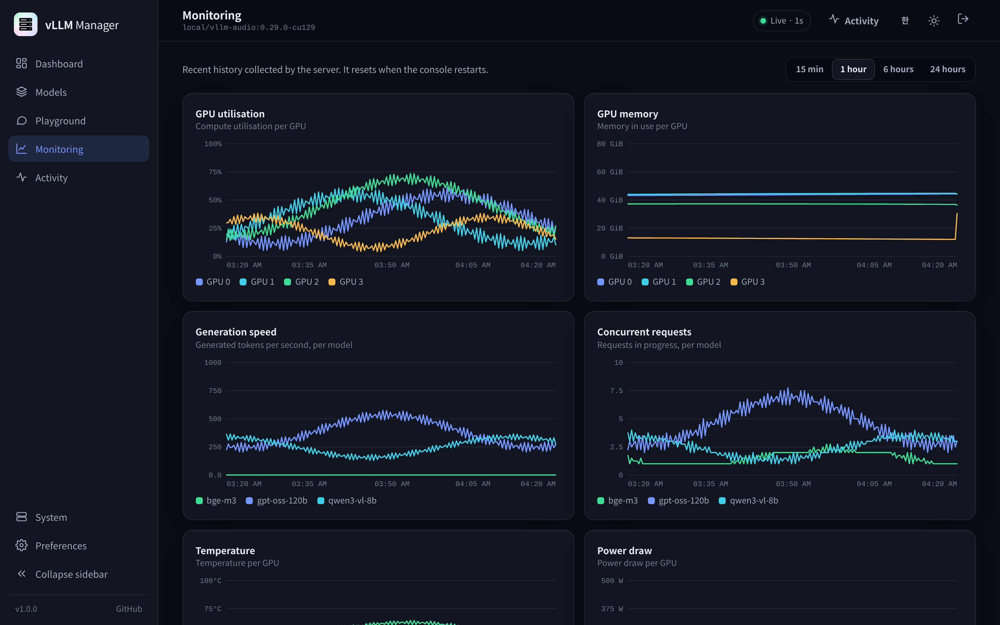
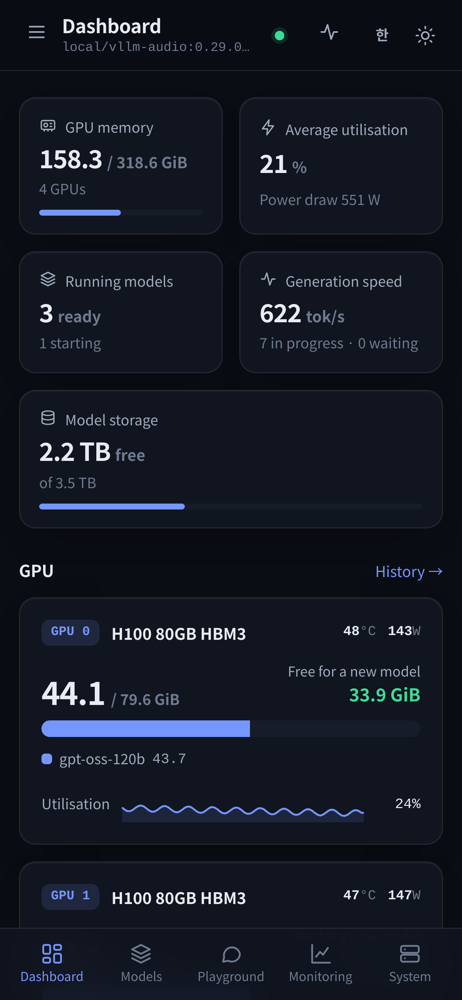
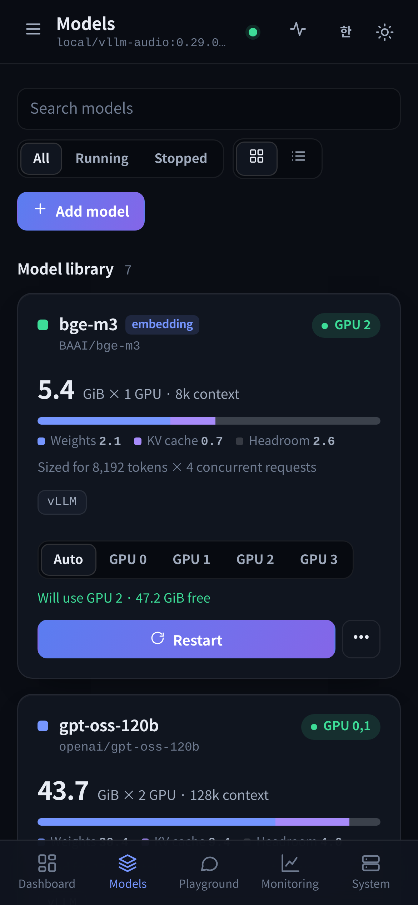
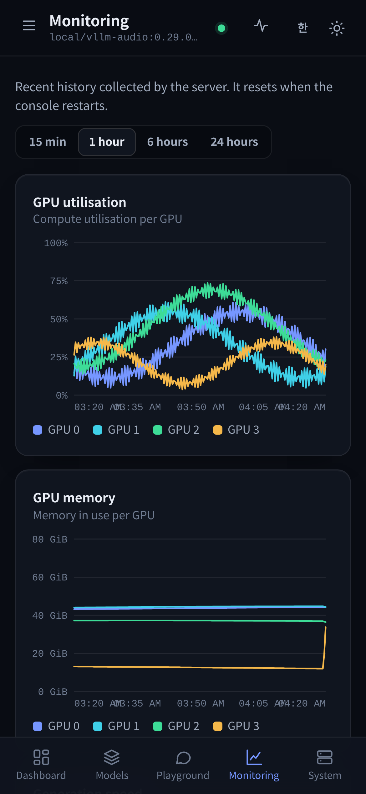
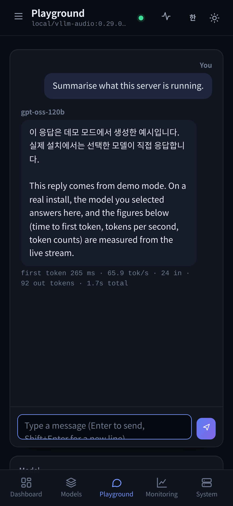

<h1 align="center">vLLM Manager</h1>

<p align="center">
  <b>Run and manage vLLM model servers on your own GPUs, from a browser or one CLI.</b><br>
  Download a model, see whether it fits before it starts, watch what each GPU is holding, and test the answer.
</p>

<p align="center">
  <a href="https://www.yojun.dev/vllm-manager/">Website</a> ·
  <a href="#quick-start">Quick start</a> ·
  <a href="#features">Features</a> ·
  <a href="#cli-reference">CLI</a> ·
  <a href="#configuration">Configuration</a> ·
  <a href="#security">Security</a>
</p>

<p align="center">
  
</p>

vLLM Manager is a self-hosted toolkit for serving models with [vLLM](https://github.com/vllm-project/vllm) and [vLLM-Omni](https://github.com/vllm-project/vllm-omni) on a GPU host. Each model runs in its own Docker container with an OpenAI-compatible API on its own port. A web console and a CLI (`./vllm`) handle the rest: downloads, config files, GPU memory planning, container lifecycle, logs, metrics and the API key.

The console is one FastAPI process with no database, no build step and no external CDN, so it also works on servers without outbound web access. English and Korean interface.

## Quick start

```bash
curl -fsSL https://raw.githubusercontent.com/yojun313/vllm-manager/main/install.sh | sh
```

You need Linux, an NVIDIA driver, Docker and the [NVIDIA Container Toolkit](https://docs.nvidia.com/datacenter/cloud-native/container-toolkit/latest/install-guide.html). The installer checks them, prints the exact command for anything missing, and never uses sudo. It:

1. installs [uv](https://docs.astral.sh/uv/) into your home folder if it is missing,
2. downloads vLLM Manager into `~/vllm-manager` and installs the console's dependencies,
3. asks for a model folder, the GPUs to use, a console port and an admin login (every question has a detected default; the password can be generated for you),
4. starts the console in the background and prints its address.

Open the address, go to **Models → Add model**, type a Hugging Face name, and press **Run** when the download finishes. The vLLM runtime image is pulled in the background on first start.

Manage the install with the same launcher:

```bash
~/vllm-manager/vllm server status    # is the console running, and where
~/vllm-manager/vllm server logs      # watch its output
~/vllm-manager/vllm server down      # stop the console (models keep running)
~/vllm-manager/vllm server up        # start it in the background
~/vllm-manager/vllm server enable    # start it at boot (systemd user service, no sudo)
~/vllm-manager/vllm doctor           # check the install and explain what is missing
~/vllm-manager/vllm update           # pull the latest version and restart the console
~/vllm-manager/vllm configure        # run the setup questions again
```

<details>
<summary>Manual install</summary>

```bash
git clone https://github.com/yojun313/vllm-manager.git
cd vllm-manager
./vllm configure        # writes .env and server/.env (or skip it and finish setup in the browser)
./vllm server up
```

If you skip `configure`, the console starts in first-run mode and prints a one-time address (`/setup?token=…`) where you create the admin account. Unattended installs can use `VLLM_MANAGER_YES=1` with the installer or `./vllm configure --yes`.
</details>

<details>
<summary>Running under PM2</summary>

`ecosystem.config.js` runs the same launcher under [PM2](https://pm2.keymetrics.io/): `pm2 start ecosystem.config.js`. The PM2 daemon must have Docker access, for example `sg docker -c "pm2 start ecosystem.config.js"` right after adding yourself to the `docker` group.
</details>

## Features

### Models

| | |
|---|---|
| **Search and download** | Search Hugging Face from the console, or `./vllm pull <repo>`. Downloads show byte-level progress, can be cancelled, and resume where they stopped. |
| **Fit check before download** | Weights, KV cache and headroom are estimated from the model's `config.json`, so you learn whether it fits on one GPU, needs several, or cannot run here before spending the disk space. |
| **Generated configs** | A config file is written for each model with the options its model card recommends (parsers, context length). Edit it in the console; the previous version is kept. |
| **Two engines** | vLLM for text, vision, audio-input and embedding models; vLLM-Omni for speech-capable models such as Qwen3-Omni. Chosen per model, and both can run side by side. |
| **GPU placement** | Pick GPUs per run or let the emptiest be chosen. Combinations that would not fit are marked before you click, and a start that would exceed free memory is refused. |

<p align="center">
  
</p>

### Monitoring and testing

| | |
|---|---|
| **GPU memory by owner** | Every GPU shows memory per managed model and per outside process (name, user, PID), so a shared server stays readable. |
| **Model metrics** | Tokens per second, requests in progress and waiting, time to first token and KV cache usage for each running model, read from vLLM's metrics endpoint. |
| **History** | 24 hours of utilisation, memory, temperature, power and per-model throughput, collected by the server whether or not a browser is open. |
| **Start-up progress** | Weight loading, compilation and CUDA graph capture as one progress bar with the live log beside it. |
| **Playground** | Send a message to a running model and read the streamed answer with its speed. The request goes through the console, so the API key never reaches the browser. |
| **Connection examples** | curl, Python and JavaScript snippets for every running model, with your public address filled in. |

<p align="center">
  
</p>

### Operations

| | |
|---|---|
| **Settings in the console** | Storage folders, GPUs to use, ports, runtime images, memory planning, public addresses, the model API key and the admin password are all changed on the System and Preferences pages. |
| **Install checks** | The System page and `./vllm doctor` list what is missing (Docker access, container toolkit, images, Hugging Face sign-in) and how to fix it. |
| **Jobs that survive restarts** | Downloads and start-ups run in processes separate from the console, so restarting or updating it does not interrupt them, and every device sees the same state. |
| **Automatic image preparation** | Missing runtime images are pulled or built in the background at start-up, with the output in the console log. |
| **Any screen** | One responsive app: sidebar on a desktop, tab bar on a phone, light and dark themes. |

<table>
  <tr>
    <td align="center" width="25%"><br><sub>Dashboard</sub></td>
    <td align="center" width="25%"><br><sub>Models</sub></td>
    <td align="center" width="25%"><br><sub>Monitoring</sub></td>
    <td align="center" width="25%"><br><sub>Playground</sub></td>
  </tr>
</table>

## Requirements

* **Linux with an NVIDIA GPU and driver.** The runtime image must use a CUDA version the driver supports (see [Engine versions](#engine-versions)). The default image runs on driver 575 and newer.
* **Docker** with the **NVIDIA Container Toolkit** (`docker run --gpus all …` must work), and your account in the `docker` group.
* **git, curl, python3 (3.8+), flock and ss** (present on most distributions).
* **uv**, installed by the installer. It provides Python 3.12 and the Hugging Face download tool for the console.

## CLI reference

```
./vllm [-n] <command> [args]
```

| Command | Description |
|---|---|
| (none) | Interactive menu to pick a model and GPUs. |
| `up <model> [-g GPU] [-p PORT] [-- engine options...]` | Start a model. If the same model already runs on the same GPUs, it is replaced. |
| `down [model\|GPU\|container]` | Stop servers. Without an argument, every server is stopped. |
| `ps` | Running servers and free memory per GPU. |
| `logs [model\|GPU\|container]` | Follow a server's log. |
| `ls` | Models and the memory each one needs. |
| `pull [repo] [alias] [--force]` | Download a model and create its config file. |
| `fit <repo>` | Only check whether a model can run on this server, without downloading. |
| `new <repo> [alias]` | Only create the config file, without downloading. |
| `rm <model> [--files]` | Delete a model config. `--files` also deletes the weights. |
| `key [new\|off]` | Show, create or remove the API key. |
| `setup` | Prepare GPU access, directories, and both serving images. Build Omni if its image is missing. |
| `omni-build` | Build or rebuild the configured Omni image with plain-text build logs. |
| `audio-build` | Build or rebuild the regular vLLM image with audio decoding support. |
| `configure [--yes]` | Setup questions: model folder, GPUs, console port, admin login. |
| `server [up\|down\|restart\|status\|logs\|start\|enable\|disable]` | Control the web console. `start` runs it in the foreground; `enable` starts it at boot. |
| `update` | Pull the latest version, refresh dependencies and restart the console. |
| `doctor` | Check the install and explain how to fix what is missing. |
| `hf-login` | Sign in to Hugging Face (needed for gated models). |

**Global option**

* `-n`, `--dry-run`: print the docker commands instead of running them.

**`up` options**

| Option | Description |
|---|---|
| `-g`, `--gpu` | GPUs to use, as `0`, `1` or `0,1`. For vLLM, multiple GPUs use tensor parallelism (TP). For Omni, the GPU count must match the deployment profile and stage placement is defined there. Without it, the `# gpus: N` count from the config is used and the GPUs with the most free memory are chosen. GPUs outside `GPU_COUNT` / `GPU_IDS` cannot be selected. |
| `-p`, `--port` | Host port. Without it, the first free port from `PORT_BASE + first GPU index` is used. Replacing the same model keeps its port. |
| `-- ...` | Everything after `--` is passed to the selected engine; the engine must support the options. For vLLM, CLI options override the config file, e.g. `./vllm up qwen3-8b -- --max-num-seqs 16`. |

Containers are named `vllm-<model>-g<GPUs>` (e.g. `vllm-qwen3-8b-g0`), so different models, or the same model on different GPUs, can run side by side.

## Model management

### Adding a model

```bash
./vllm pull Qwen/Qwen3-8B                          # alias is the lower-cased repo name (qwen3-8b)
./vllm pull https://huggingface.co/Qwen/Qwen3-8B    # URLs work too
./vllm pull Qwen/Qwen3-8B my-qwen                  # custom alias
```

`pull` works in three steps:

1. **Fit check for vLLM**: the needed memory is calculated from the Hugging Face `config.json` and file sizes only. If the model cannot run on all usable GPUs (`GPU_COUNT`) even in the lightest setting (4,096-token context, 1 concurrent request), you are asked before downloading. Outside a terminal it stops unless `--force` is given.
2. **Download** into `MODELS_DIR/<org>__<name>`, skipping folders vLLM does not use (`original/`, `metal/`, `onnx/`, `openvino/`). An interrupted download resumes with the same command.
3. **Config file**: `models/<alias>.yaml` is created. For an existing config that still points to the same HF repository, only `model` is updated to the downloaded `/models/<org>__<name>` path; custom settings and unrelated model paths are preserved. Qwen3-Omni-30B-A3B checkpoints select the Omni engine and a two-GPU deployment profile. Instruct uses the full speech pipeline; Thinking, Captioner, or checkpoints with `enable_audio_output: false` use the Thinker-only profile. Local architecture metadata also identifies renamed Qwen3-Omni forks. The Qwen3-Omni repository-name fit check reports unknown rather than using the regular TP estimator.

For regular vLLM models, the generated config includes the following. It is printed after creation, so you can adjust it.

* The recommended GPU count, based on the weight size.
* The `vllm serve` options recommended in the model card.
* `trust-remote-code` (when the repo ships custom code) and embedding models (`runner: pooling`).
* Reasoning and tool-call parsers per model family (Qwen, gpt-oss, Nemotron, Llama).

### Config file format

`models/*.yaml` selects a model and serving engine. The `# engine:` comment accepts `vllm` or `vllm-omni`; omitting it selects vLLM. For vLLM, keys follow the official config file format: CLI option names without the leading `--`.

```yaml
# engine: vllm                  # serving engine (optional for vLLM)
# gpus: 1                       # vllm-manager only: recommended GPU count
# concurrency: 4                # vllm-manager only: concurrent requests for KV cache sizing (optional)
model: /models/Qwen__Qwen3-8B   # downloaded models live in /models/<folder>; a HF repo id is downloaded at start
served-model-name: Qwen/Qwen3-8B
max-model-len: auto             # or a fixed number within the model/tokenizer limit
reasoning-parser: qwen3
enable-auto-tool-choice: true
tool-call-parser: hermes
```

For vLLM, `./vllm up` manages TP, host, port, and automatically calculated memory options. Setting `gpu-memory-utilization` manually opts out of automatic memory sizing.

Ready-to-copy model configs are provided in `deploy/`:

| Example | Engine | Purpose |
|---|---|---|
| [vllm-model.yaml.example](deploy/vllm-model.yaml.example) | vLLM | Qwen3-8B text chat with reasoning and tool calling |
| [music-flamingo-model.yaml.example](deploy/music-flamingo-model.yaml.example) | vLLM | Music Flamingo audio understanding with an 8192-token context and one request for memory planning |
| [qwen3-omni-model.yaml.example](deploy/qwen3-omni-model.yaml.example) | vLLM-Omni | Qwen3-Omni with stage-specific GPU placement |

Copy an example into `models/` with a `.yaml` extension before starting it:

```bash
cp deploy/vllm-model.yaml.example models/qwen3-8b.yaml
./vllm up qwen3-8b -g 0

cp deploy/music-flamingo-model.yaml.example models/music-flamingo-hf.yaml
./vllm up music-flamingo-hf -g 0
```

Copy only when the destination config does not exist, or preserve your local settings before replacing it. Repository IDs download weights on first start. For weights downloaded with `./vllm pull`, use the corresponding `/models/<org>__<name>` path shown in the example. Music Flamingo uses the regular vLLM engine; omit `tools` and `tool_choice` from its API requests.

For Omni, the model file contains engine metadata and a reference to a deployment profile:

```yaml
# engine: vllm-omni
# gpus: 2
# memory-fraction: 0.9
# deploy-config: qwen3-omni.yaml
model: Qwen/Qwen3-Omni-30B-A3B-Instruct
```

The `deploy-config` value is a filename under `deploy/`. Stage device indices are local to the container. Use `qwen3-omni.yaml` for text and speech output, or `qwen3-omni-thinking.yaml` for a Thinker-only pipeline with text output and multimodal inputs. The Thinker-only profile also accepts Instruct weights and uses TP=2. Both profiles set the context to 8192 and concurrency to 1. See `deploy/qwen3-omni-model.yaml.example` for a model config template.

Omni 0.29 rejects global `--served-model-name` for this pipeline, so the launcher uses the engine's default API model name: the `model` value. The console displays the same name, including the container path when using local weights. Regular vLLM configs can set `served-model-name`.

### Removing a model

```bash
./vllm rm qwen3-8b            # config file only
./vllm rm qwen3-8b --files    # config and weights
```

A running model cannot be removed. Weights are kept if another config uses the same weights, or if the weight folder is not directly under `MODELS_DIR` or `HF_CACHE_DIR`.

## GPU memory planning

### How much a model needs

For regular vLLM models, `./vllm up` estimates a GPU reservation from the weights, KV cache, and working memory. `./vllm ls` shows the plan.

```
Memory per GPU = weights / TP + KV cache + working memory
KV cache       = KV bytes per token × max-model-len × concurrent requests
Working memory = 2.5 GiB + 5% of the weights (+ 2 GiB for vision models)
```

* KV bytes per token come from the layer count, KV head count and head dimension in `config.json`. Sliding-window layers and linear-attention / Mamba layers are excluded.
* vLLM receives the computed KV cache size (`--kv-cache-memory-bytes`) and a matching `--gpu-memory-utilization`.
* With `max-model-len: auto`, the longest context whose KV cache fits in `AUTO_KV_GIB` (default 16 GiB) is chosen without exceeding the limits in the model and tokenizer configs. An explicit length above those limits is rejected before launch.
* Concurrent requests default to `KV_CONCURRENCY` (4): that many full-length requests fit at once. Shorter requests can run in larger numbers.
* Setting `gpu-memory-utilization` in a config disables the automatic sizing for that model.

### Omni pipeline reservations

Omni uses stage-specific memory settings in `deploy/` instead of the regular weights / TP estimator. The model config's `# memory-fraction: 0.9` reserves 90% of each selected GPU for scheduling checks. On an 80 GiB GPU, this is approximately 72 GiB per GPU, plus the free safety margin. If stage memory utilization is increased, raise the reservation to cover the sum of all stage allocations on each GPU.

The full Qwen3-Omni profile assigns Thinker to one GPU and Talker / Code2Wav to the other; the Thinker-only profile distributes Thinker across both GPUs. These reservations are estimates for scheduling, not measured peak usage. Input length and concurrency affect actual memory consumption.

### Running several models together

vLLM and Omni servers run in separate containers and can run simultaneously when the GPU reservations fit. A two-GPU Omni deployment may require stopping other large models first. Starting one model does not automatically stop unrelated models.

Before starting, the free memory of the target GPUs is checked; if it is not enough, the start is refused without changing anything. Free memory is counted per GPU process:

* Models started by vllm-manager: the larger of actual use and reservation (models still starting count with their full reservation).
* Other processes: actual use.
* `SAFETY_MIB` (default 2 GiB) is kept free on every GPU as a margin.

## Configuration

You do not need to edit files by hand. `./vllm configure` asks the setup questions again, and the console's **System → Server settings** changes every value below. Serving settings apply to the next model you start; console settings (port, bind address, cookie) apply after a console restart, which the page offers to do.

The values are stored in two files that Git ignores:

**`.env` (model serving)**

| Key | Meaning |
|---|---|
| `MODELS_DIR` | Folder for downloaded weights, mounted as `/models` in the containers |
| `HF_CACHE_DIR` | Where models referenced by repo id are downloaded automatically |
| `VLLM_CACHE_DIR` | Compile cache; makes later starts faster |
| `GPU_IDS` / `GPU_COUNT` | GPUs to use: a list such as `0,2`, or the first N. Both empty = all |
| `PORT_BASE` | Model port = `PORT_BASE` + index of the model's first GPU |
| `BIND_ADDR` | `0.0.0.0` to accept outside connections on model ports, `127.0.0.1` for this host only |
| `VLLM_IMAGE` | Base vLLM image |
| `VLLM_AUDIO_IMAGE` | Optional image with `vllm[audio]`, built automatically; used for regular models when set |
| `VLLM_OMNI_IMAGE` | Optional vLLM-Omni image, built automatically; empty disables Omni |
| `KV_CONCURRENCY`, `AUTO_KV_GIB`, `SAFETY_MIB` | Memory planning (see [GPU memory planning](#gpu-memory-planning)) |

**`server/.env` (web console)**

| Key | Meaning |
|---|---|
| `ADMIN_USERNAME`, `ADMIN_PASS_HASH` | Admin login. The password is stored as a PBKDF2 hash |
| `SESSION_SECRET`, `SESSION_DAYS` | Session cookie signing key and lifetime |
| `HOST`, `PORT` | Console bind address and port |
| `COOKIE_SECURE` | `true` sends the session cookie over HTTPS only |
| `MODEL_PUBLIC_URL_<port>` | Public address for a model port, used by Copy URL and the connection examples |

## Security

The console controls Docker on the host, so treat its login like a root password.

* Every page and API route except the sign-in page requires a session. Passwords are stored as PBKDF2 hashes; sessions are signed cookies (`HttpOnly`, `SameSite=Strict`), and changing the password signs out other devices.
* **Passkeys**: add one under Preferences → Passkeys and sign in with the device's fingerprint, face or PIN instead of the password. A passkey on a phone can sign in a desktop browser through the browser's QR code. Browsers only allow passkeys over HTTPS (or on `localhost`), and a passkey is bound to the address it was created on. Adding one asks for the password again; only public keys are stored (`server/data/passkeys.json`).
* Sign-in is rate-limited per address. Cross-origin requests and WebSocket connections are refused. The FastAPI docs endpoints are disabled, and responses carry a strict Content-Security-Policy.
* First-run setup requires a one-time token printed in the server log, so an open port cannot be claimed by someone else.
* **Use HTTPS when the console is reachable from other networks.** Put it behind a reverse proxy or a tunnel (nginx, Caddy, Tailscale, Cloudflare Tunnel), then turn on **Secure cookie** in System → Server settings.
* Model ports are separate from the console. Create an API key (System → API key, or `./vllm key new`) so that model servers only answer requests with `Authorization: Bearer <key>`.

## API authentication

```bash
./vllm key new    # create a key and store it in api-key.env (mode 600)
./vllm key        # show the current key
./vllm key off    # turn authentication off
```

The key applies to servers started with `./vllm up` after the change. Clients must send `Authorization: Bearer <key>`.

> **Security note** vLLM's API key only protects the `/v1`, `/v2`, `/inference` and `/cohere` paths. `/invocations`, `/pooling`, `/score`, `/pause`, `/abort_requests` and others stay open ([vLLM security docs](https://docs.vllm.ai/en/latest/usage/security.html#api-key-authentication-limitations)). When exposing models publicly, set `BIND_ADDR=127.0.0.1` in the root `.env` and put a reverse proxy in front that forwards only `/v1`.

## Connecting clients

Both engines provide OpenAI-compatible chat APIs under `/v1`, including `/v1/chat/completions`. For vLLM, use `served-model-name` if configured; for Omni, use the config's `model` value. Query `/v1/models` to confirm the actual names. API compatibility does not imply support for every OpenAI endpoint or identical audio/video response handling.

**curl**

```bash
curl http://<server>:<port>/v1/chat/completions \
  -H 'Content-Type: application/json' \
  -H "Authorization: Bearer $(./vllm key)" \
  -d '{"model": "openai/gpt-oss-20b", "messages": [{"role": "user", "content": "Hello"}]}'
```

**OpenAI Python SDK**

```python
from openai import OpenAI

client = OpenAI(base_url="http://<server>:<port>/v1", api_key="<API key>")
resp = client.chat.completions.create(
    model="openai/gpt-oss-20b",
    messages=[{"role": "user", "content": "Hello"}],
)
print(resp.choices[0].message.content)
```

**Qwen3-Omni text and speech output**

The full speech pipeline accepts `modalities=["text", "audio"]`; use `["text"]` for text output only. Non-streaming responses can contain separate text and audio choices:

```python
import base64
from pathlib import Path

response = client.chat.completions.create(
    model="Qwen/Qwen3-Omni-30B-A3B-Instruct",
    messages=[{"role": "user", "content": "Introduce yourself briefly."}],
    modalities=["text", "audio"],
)
for choice in response.choices:
    if choice.message.content:
        print(choice.message.content)
    audio = getattr(choice.message, "audio", None)
    if audio and audio.data:
        Path("output.wav").write_bytes(base64.b64decode(audio.data))
```

Audio and video requests require a client that can send the model's multimodal input format. See the [vLLM multimodal input guide](https://docs.vllm.ai/en/latest/features/multimodal_inputs/) and [Qwen3-Omni serving examples](https://docs.vllm.ai/projects/vllm-omni/en/latest/user_guide/examples/online_serving/qwen3_omni/).

**Open WebUI**

Add a connection under Admin Settings → Connections → OpenAI API:

| Field | Value |
|---|---|
| URL | `http://<server>:<port>/v1` (including `/v1`) |
| Key | the output of `./vllm key` |
| Model IDs | leave empty to fetch them from the server |

If Open WebUI runs in a docker container on the same server, use the docker bridge address (usually `172.17.0.1`) instead of `localhost`.

For models without tool calling support, disable tool use in the client and omit `tools` / `tool_choice` from requests. Audio input and Omni speech output require compatible client handling; an OpenAI-compatible connection alone does not ensure that a UI forwards original music/audio or plays Omni responses.

For models served at a fixed address through a reverse proxy or gateway, pin the port with `-p`. Otherwise the port is whichever one is free at start time.

## Engine versions

Pin the vLLM version with `VLLM_IMAGE` in the root `.env`; avoid the `latest` tag.

The image tag must match the CUDA version supported by your GPU driver. vLLM's default tags (`latest`, `v0.30.0`, …) are built on CUDA 13 and need driver 580 or newer. With driver 575 (CUDA 12.9), use tags ending in `-cu129`. Available tags are listed on [Docker Hub](https://hub.docker.com/r/vllm/vllm-openai/tags).

| Tag | Status |
|---|---|
| `v0.29.0-cu129` | Recommended (current default) |
| `v0.30.0-cu129` | Broken: torch (`2.14.0+cu130`) and torchvision (`cu129`) in the image do not match, so start-up fails ([vllm#56829](https://github.com/vllm-project/vllm/issues/56829)). |

`docker/omni.Dockerfile` builds the Omni image from `VLLM_IMAGE` and pins Omni 0.29.0rc1 to commit `aff7d64948f6c0e81e9b3272234623044e215967`. Dependency constraints preserve the base image's vLLM, PyTorch, and CUDA package versions; incompatible requirements fail the build instead of replacing that stack. Changing the base version requires checking Omni compatibility as well.

`docker/audio.Dockerfile` installs the matching `vllm[audio]` extras while preserving the base CUDA/PyTorch stack. Regular model servers use `VLLM_AUDIO_IMAGE` when configured. This includes the PyAV, SciPy, SoundFile, and soxr dependencies needed to decode and resample Music Flamingo audio. Run `./vllm audio-build` to rebuild this image, then restart the affected model containers to apply it. Both BuildKit and the legacy Docker builder stream their output to setup logs.

Run `./vllm omni-build` to rebuild the configured Omni tag after changing the Dockerfile or its base image. Startup reuses an existing image tag, so it does not rebuild solely because source files changed. Image builds require Docker access and network connectivity.

After changing the version, check that the log lines used by the start-up progress tracker (`server/app/services/progress.py`) have not changed.

## Troubleshooting

| Symptom | Cause and fix |
|---|---|
| `Unable to find image ... locally` | The image is being pulled automatically. The first start takes a few minutes. |
| `RuntimeError: operator torchvision::nms does not exist` | torch and torchvision in the image do not match. Use the recommended tag in [Engine versions](#engine-versions). |
| Start refused for lack of space | Choose other GPUs (`-g`), free memory with `./vllm down`, or lower `max-model-len` in the config. |
| `502 Bad Gateway` from a gateway | No model server is on the port the gateway forwards to. Pin the port with `-p`. |
| The console shows "Docker is not reachable" | Add the account to the `docker` group (`sudo usermod -aG docker $USER`), sign in again, and restart the console. Under PM2, the PM2 daemon itself must be restarted with the new group. |
| "Preparing the runtime failed" banner | An image could not be pulled or built. Read the output in `./vllm server logs`, fix the cause, then press Try again. |
| Cannot sign in over plain HTTP | **Secure cookie** is on, so the browser withholds the session cookie. Turn it off in System → Server settings (or set `COOKIE_SECURE=false` in `server/.env`) until the console is behind HTTPS. |
| Omni startup stays at `Using model weights format` | First startup can download large weights without a progress bar in that log. Check the HF cache for growing `.incomplete` files. |
| `User-specified max_model_len ... greater than ...` | Keep the context within the model/tokenizer limit or use `max-model-len: auto`. |
| `auto` tool choice requires a parser | Disable tool use for models without tool calling support; omit `tools` and `tool_choice`. |
| Repeated `KeyboardInterrupt` in the PM2 log during start-up | PM2 watch restarts on `__pycache__` changes. Use the repository's `ecosystem.config.js` (`watch`, `ignore_watch`). |

## Project structure

```text
vllm                  CLI: model lifecycle, console control, doctor, update
install.sh            one-line installer
tools/setup.py        setup questions (writes .env and server/.env)
lib/                  memory planning, config generation, GPU accounting
docker/               Dockerfiles for the audio and Omni images
deploy/               Omni stage deployment profiles and config examples
models/               your model configs (not tracked by Git)
server/               web console (FastAPI, plain ES modules, no build step)
docs/                 project website (GitHub Pages)
```
