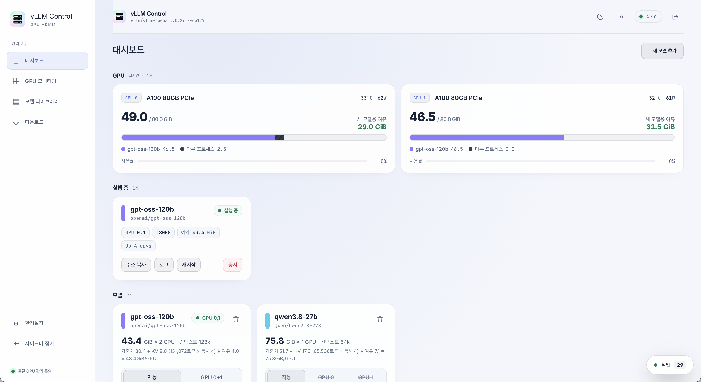
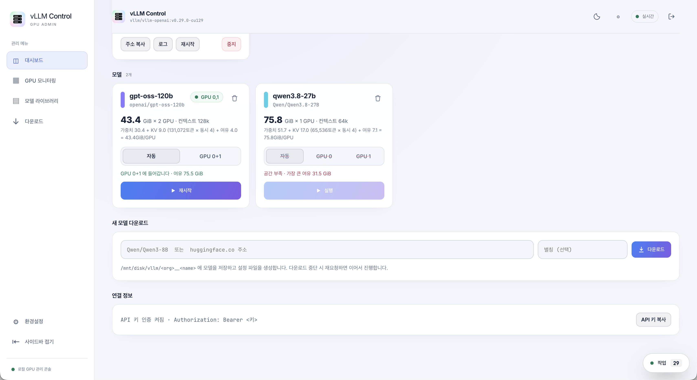

# vllm-manager

A self-hosted toolkit for **serving several LLMs on one GPU server with [vLLM](https://github.com/vllm-project/vllm)**. Each model is described by a single config file, and one CLI (`./vllm`) downloads, sizes, starts, stops and removes OpenAI-compatible vLLM servers in Docker. GPU memory is calculated per model, so several models can share a GPU without running out of memory. A web console (**vLLM Control**) does the same work from the browser, including on the phone.

Built on Docker + vLLM for serving and FastAPI for the web console.

<table>
  <tr>
    <td align="center" width="50%"><br><sub>Dashboard: live GPU memory per model, running servers, memory plan per model</sub></td>
    <td align="center" width="50%"><br><sub>Fit check per GPU before starting, model download, API key</sub></td>
  </tr>
</table>

---

## 1. Features

* **Declarative model configs**: one YAML file per model in vLLM's official config file format (`--config`).
* **Automatic GPU memory planning**: the memory each model needs is calculated from its architecture (`config.json`), and only that much is reserved. Several models can run on the same GPU, and a model that does not fit is refused before anything is changed.
* **Download & config generation**: pull a Hugging Face repository and get a config file with the options recommended in the model card. Before downloading, the tool checks whether the model can run on this server at all.
* **Tensor parallel & multi-GPU**: pick GPUs per run (`-g 0,1`), or let the tool choose the GPUs with the most free memory. The same model can run on different GPUs at the same time.
* **Web console (vLLM Control)**: start / restart / stop / delete models, download models with byte-level progress, watch GPU memory / utilization / temperature / power, and follow start-up progress (weight loading, compile, CUDA graph capture) and logs live, from any browser including mobile.
* **Jobs that survive restarts**: downloads and start-ups run in processes separate from the web server, so restarting the console does not interrupt them, and every device sees the same state.
* **API key authentication** for the vLLM servers.

---

## 2. System Requirements

* **NVIDIA GPU and driver**. The vLLM image must match the CUDA version the driver supports (see [vLLM Version](#11-vllm-version)).
* **Docker** with the [NVIDIA Container Toolkit](https://docs.nvidia.com/datacenter/cloud-native/container-toolkit/) (`docker run --gpus` must work).
* **`hf` CLI**: `pip install -U huggingface_hub`. Gated models need `hf auth login`.
* **Python 3.8+, `bc`, `ss` (iproute2)** for the CLI.
* **[uv](https://docs.astral.sh/uv/) and Python 3.12** for the web console only.
* **[PM2](https://pm2.keymetrics.io/)** to keep the web console running (optional).

---

## 3. Installation

### 1) Clone

```bash
git clone https://github.com/yojun313/vllm-manager.git
cd vllm-manager
```

### 2) Configuration

```bash
cp .env.example .env
```

The root `.env` holds the vLLM settings and is not tracked by Git (`server/.env` is only for the web console login). Check these keys for your server; the full list is in the [Configuration Reference](#10-configuration-reference).

* `VLLM_IMAGE`: an image tag built for the CUDA version your driver supports.
* `MODELS_DIR`, `HF_CACHE_DIR`, `VLLM_CACHE_DIR`: where model weights and caches are stored.
* `GPU_COUNT` or `GPU_IDS`: which GPUs vllm-manager may use. Leave both empty to use every detected GPU.

Model configs in `models/` are server-specific and not part of the repository. The folder is empty after installation; add models with `./vllm pull`.

### 3) Quick Start

```bash
# 1. Download a model (creates models/qwen3-8b.yaml)
./vllm pull Qwen/Qwen3-8B

# 2. Start it
./vllm up qwen3-8b

# 3. Send a request (use the address printed by `up`)
curl http://localhost:8000/v1/chat/completions \
  -H 'Content-Type: application/json' \
  -d '{"model": "Qwen/Qwen3-8B", "messages": [{"role": "user", "content": "Hello"}]}'
```

`./vllm up` follows the start-up log until the server accepts requests, then prints the address and an example request and exits. The server keeps running in the background. The port depends on the chosen GPU and on which ports are free. If [API authentication](#8-api-authentication) is on, an `Authorization` header is required.

---

## 4. CLI Reference

```
./vllm [-n] <command> [args]
```

| Command | Description |
|---|---|
| (none) | Interactive menu to pick a model and GPUs. |
| `up <model> [-g GPU] [-p PORT] [-- vLLM options...]` | Start a model. If the same model already runs on the same GPUs, it is replaced. |
| `down [model\|GPU\|container]` | Stop servers. Without an argument, every server is stopped. |
| `ps` | Running servers and free memory per GPU. |
| `logs [model\|GPU\|container]` | Follow a server's log. |
| `ls` | Models and the memory each one needs. |
| `pull [repo] [alias] [--force]` | Download a model and create its config file. |
| `fit <repo>` | Only check whether a model can run on this server, without downloading. |
| `new <repo> [alias]` | Only create the config file, without downloading. |
| `rm <model> [--files]` | Delete a model config. `--files` also deletes the weights. |
| `key [new\|off]` | Show, create or remove the API key. |

**Global option**

* `-n`, `--dry-run`: print the docker commands instead of running them.

**`up` options**

| Option | Description |
|---|---|
| `-g`, `--gpu` | GPUs to use, as `0`, `1` or `0,1`. Multiple GPUs run with tensor parallelism (TP). Without it, the `# gpus: N` count from the config is used and the GPUs with the most free memory are chosen. GPUs outside `GPU_COUNT` / `GPU_IDS` cannot be selected. |
| `-p`, `--port` | Host port. Without it, the first free port from `PORT_BASE + first GPU index` is used. Replacing the same model keeps its port. |
| `-- ...` | Everything after `--` is passed to vLLM as-is and overrides the config file, e.g. `./vllm up qwen3-8b -- --max-num-seqs 16`. |

Containers are named `vllm-<model>-g<GPUs>` (e.g. `vllm-qwen3-8b-g0`), so different models, or the same model on different GPUs, can run side by side.

---

## 5. Model Management

### Adding a model

```bash
./vllm pull Qwen/Qwen3-8B                          # alias is the lower-cased repo name (qwen3-8b)
./vllm pull https://huggingface.co/Qwen/Qwen3-8B    # URLs work too
./vllm pull Qwen/Qwen3-8B my-qwen                  # custom alias
```

`pull` works in three steps:

1. **Fit check**: the needed memory is calculated from the Hugging Face `config.json` and file sizes only. If the model cannot run on all usable GPUs (`GPU_COUNT`) even in the lightest setting (4,096-token context, 1 concurrent request), you are asked before downloading. Outside a terminal it stops unless `--force` is given.
2. **Download** into `MODELS_DIR/<org>__<name>`, skipping folders vLLM does not use (`original/`, `metal/`, `onnx/`, `openvino/`). An interrupted download resumes with the same command.
3. **Config file**: `models/<alias>.yaml` is created (an existing file is never overwritten).

The generated config includes the following. It is printed after creation, so you can adjust it.

* The recommended GPU count, based on the weight size.
* The `vllm serve` options recommended in the model card.
* `trust-remote-code` (when the repo ships custom code) and embedding models (`runner: pooling`).
* Reasoning and tool-call parsers per model family (Qwen, gpt-oss, Nemotron, Llama).

### Config file format

`models/*.yaml` uses vLLM's official config file format: keys are vLLM CLI option names without the leading `--`.

```yaml
# gpus: 1                       # vllm-manager only: recommended GPU count
# concurrency: 4                # vllm-manager only: concurrent requests for KV cache sizing (optional)
model: /models/Qwen__Qwen3-8B   # downloaded models live in /models/<folder>; a HF repo id is downloaded at start
served-model-name: Qwen/Qwen3-8B
max-model-len: auto             # or a fixed number, e.g. 32768
reasoning-parser: qwen3
enable-auto-tool-choice: true
tool-call-parser: hermes
```

Do not put `--tensor-parallel-size`, `--host`, `--port` or memory options in the config; `./vllm up` sets them.

### Removing a model

```bash
./vllm rm qwen3-8b            # config file only
./vllm rm qwen3-8b --files    # config and weights
```

A running model cannot be removed. Weights are kept if another config uses the same weights, or if the weight folder is not directly under `MODELS_DIR` or `HF_CACHE_DIR`.

---

## 6. GPU Memory Planning

### How much a model needs

`./vllm up` reserves exactly the memory each model needs. `./vllm ls` shows the numbers.

```
Memory per GPU = weights / TP + KV cache + working memory
KV cache       = KV bytes per token × max-model-len × concurrent requests
Working memory = 2.5 GiB + 5% of the weights (+ 2 GiB for vision models)
```

* KV bytes per token come from the layer count, KV head count and head dimension in `config.json`. Sliding-window layers and linear-attention / Mamba layers are excluded.
* vLLM receives the computed KV cache size (`--kv-cache-memory-bytes`) and a matching `--gpu-memory-utilization`.
* With `max-model-len: auto`, the longest context whose KV cache fits in `AUTO_KV_GIB` (default 16 GiB) is chosen, with a minimum of 32,768 tokens.
* Concurrent requests default to `KV_CONCURRENCY` (4): that many full-length requests fit at once. Shorter requests can run in larger numbers.
* Setting `gpu-memory-utilization` in a config disables the automatic sizing for that model.

### Running several models together

Before starting, the free memory of the target GPUs is checked; if it is not enough, the start is refused without changing anything. Free memory is counted per GPU process:

* Models started by vllm-manager: the larger of actual use and reservation (models still starting count with their full reservation).
* Other processes: actual use.
* `SAFETY_MIB` (default 2 GiB) is kept free on every GPU as a margin.

---

## 7. Web Console (vLLM Control)

`server/` is a FastAPI web console. Every action calls `./vllm`, so the same rules apply as on the command line.

* Full-width layout with a collapsible sidebar and a mobile menu.
* Light / dark / system theme and a compact mode.
* Settings for the GPU push interval (1 · 2 · 5 · 10 · 30 s), the model / job refresh interval (2 · 5 · 10 · 30 s), pausing GPU updates, and showing temperature / power.
* Start, restart, stop and delete models; per-GPU fit check before starting.
* Model download with byte-level progress, speed, ETA, and a confirmation for models that will not fit.
* Live memory, utilization, temperature and power for the GPUs selected by `GPU_COUNT` / `GPU_IDS`.
* Start-up progress by stage (weight loading, compile, CUDA graph capture…) and live logs.
* Username / password login.

Jobs run in processes separate from the web server, and their records and logs are stored in `server/data/jobs/`. Restarting the web server does not interrupt running downloads or start-ups, and every device and browser sees the same state.

Display settings are stored in the browser's local storage and do not affect other devices. Refresh intervals apply to the current WebSocket connection and are restored on reconnect. Pausing GPU updates still shows the initial state once on connect, and the server keeps reading the GPUs internally for fit checks. Changing settings does not cancel an open job log subscription.

### 1) Docker permission

The console must be able to use docker without sudo. Add the user that runs it to the `docker` group:

```bash
sudo usermod -aG docker $USER
```

Group changes apply to new login sessions. To use it without logging in again, run the following commands with `sg docker -c "..."`.

### 2) Environment and account

```bash
uv sync --project server --python 3.12

cp server/.env.example server/.env
```

Set the login account and session key in `server/.env`. Behind an HTTPS proxy the session cookie is `Secure`; only expose the console to the outside through an HTTPS proxy.

| Key | Description | Default |
|---|---|---|
| `ADMIN_USERNAME` | Login user name | (required) |
| `ADMIN_PASSWORD` | A strong login password | (required) |
| `SESSION_SECRET` | Signing key that keeps sessions across restarts. Generate with `python3 -c "import secrets; print(secrets.token_hex(32))"`. Empty means everyone is logged out on restart. | random |
| `SESSION_DAYS` | How long a login lasts (days) | `14` |
| `COOKIE_SECURE` | Send the session cookie over HTTPS only. Set `false` only for local HTTP development. | `true` |
| `PORT` | Web server port | `8000` |
| `HOST` | Bind address. `127.0.0.1` allows access from the server only. | `0.0.0.0` |
| `MODEL_PUBLIC_URL_<port>` | What "copy address" copies for that model port, e.g. `MODEL_PUBLIC_URL_8000=llm0.example.com/v1` | `http://<current host>:<port>/v1` |

The copy-address value is used exactly as written. Restart the console and reload the page after changing it.

> **Note** The console's default `PORT` 8000 is the same as the default model port (`PORT_BASE` in the root `.env`). If models run on the same server, pick another port such as `8021`. Swagger UI (`/docs`), ReDoc (`/redoc`) and the OpenAPI schema (`/openapi.json`) are disabled.

### 3) Run

```bash
# Foreground
uv run --project server python server/run.py

# Keep it running with PM2
pm2 start ecosystem.config.js
pm2 save
```

`ecosystem.config.js` restarts the console when `server/app/`, `run.py`, `server/.env` or the root `.env` changes. Without PM2, restart the console after editing the root `.env`.

> **Important** Apps started by PM2 inherit the permissions of the PM2 daemon. A daemon that was already running before you joined the `docker` group cannot reach docker, and neither can the console. Restart the daemon with the new permissions (this restarts the other PM2 apps too):
>
> ```bash
> pm2 save                                   # save the current app list
> sg docker -c "pm2 kill && pm2 resurrect"   # restart the daemon with docker access and restore the apps
> ```

If docker is not reachable, a notice appears at the top of the console and start / stop / delete are disabled.

---

## 8. API Authentication

```bash
./vllm key new    # create a key and store it in api-key.env (mode 600)
./vllm key        # show the current key
./vllm key off    # turn authentication off
```

The key applies to servers started with `./vllm up` after the change. Clients must send `Authorization: Bearer <key>`.

> **Security note** vLLM's API key only protects the `/v1`, `/v2`, `/inference` and `/cohere` paths. `/invocations`, `/pooling`, `/score`, `/pause`, `/abort_requests` and others stay open ([vLLM security docs](https://docs.vllm.ai/en/latest/usage/security.html#api-key-authentication-limitations)). When exposing models publicly, set `BIND_ADDR=127.0.0.1` in the root `.env` and put a reverse proxy in front that forwards only `/v1`.

---

## 9. Connecting Clients

Every server provides the OpenAI-compatible API (`/v1`). The model name is the config's `served-model-name`.

**curl**

```bash
curl http://<server>:<port>/v1/chat/completions \
  -H 'Content-Type: application/json' \
  -H "Authorization: Bearer $(./vllm key)" \
  -d '{"model": "openai/gpt-oss-20b", "messages": [{"role": "user", "content": "Hello"}]}'
```

**OpenAI Python SDK**

```python
from openai import OpenAI

client = OpenAI(base_url="http://<server>:<port>/v1", api_key="<API key>")
resp = client.chat.completions.create(
    model="openai/gpt-oss-20b",
    messages=[{"role": "user", "content": "Hello"}],
)
print(resp.choices[0].message.content)
```

**Open WebUI**

Add a connection under Admin Settings → Connections → OpenAI API:

| Field | Value |
|---|---|
| URL | `http://<server>:<port>/v1` (including `/v1`) |
| Key | the output of `./vllm key` |
| Model IDs | leave empty to fetch them from the server |

If Open WebUI runs in a docker container on the same server, use the docker bridge address (usually `172.17.0.1`) instead of `localhost`.

For models served at a fixed address through a reverse proxy or gateway, pin the port with `-p`. Otherwise the port is whichever one is free at start time.

---

## 10. Configuration Reference

Keys in the root `.env`:

| Key | Description | Default |
|---|---|---|
| `VLLM_IMAGE` | vLLM docker image | `vllm/vllm-openai:v0.29.0-cu129` |
| `MODELS_DIR` | Model weights. Mounted read-only as `/models` in the container. | `/mnt/disk/vllm` |
| `HF_CACHE_DIR` | Cache used when a config's `model` is a HF repo id | `/mnt/disk/vllm/hf-cache` |
| `VLLM_CACHE_DIR` | torch.compile / CUDA graph cache; makes restarts faster | `/mnt/disk/vllm/vllm-cache` |
| `GPU_COUNT` | Number of GPUs to use, starting from the lowest index | `2` |
| `GPU_IDS` | GPU indices to use (e.g. `0,2`); takes precedence over `GPU_COUNT` | (empty) |
| `PORT_BASE` | First model server port | `8000` |
| `BIND_ADDR` | Bind address of the model server ports | `0.0.0.0` |
| `KV_CONCURRENCY` | Concurrent requests used for KV cache sizing | `4` |
| `AUTO_KV_GIB` | KV cache limit (GiB) for `max-model-len: auto` | `16` |
| `SAFETY_MIB` | Memory kept free on every GPU (MiB) | `2048` |

If a Hugging Face token exists (`~/.cache/huggingface/token`), it is mounted read-only into the container for gated model downloads.

---

## 11. vLLM Version

Pin the vLLM version with `VLLM_IMAGE` in the root `.env`; avoid the `latest` tag.

The image tag must match the CUDA version supported by your GPU driver. vLLM's default tags (`latest`, `v0.30.0`, …) are built on CUDA 13 and need driver 580 or newer. With driver 575 (CUDA 12.9), use tags ending in `-cu129`. Available tags are listed on [Docker Hub](https://hub.docker.com/r/vllm/vllm-openai/tags).

| Tag | Status |
|---|---|
| `v0.29.0-cu129` | Recommended (current default) |
| `v0.30.0-cu129` | Broken: torch (`2.14.0+cu130`) and torchvision (`cu129`) in the image do not match, so start-up fails ([vllm#56829](https://github.com/vllm-project/vllm/issues/56829)). |

After changing the version, check that the log lines used by the start-up progress tracker (`server/app/services/progress.py`) have not changed.

---

## 12. Troubleshooting

| Symptom | Cause and fix |
|---|---|
| `Unable to find image ... locally` | The image is being pulled automatically. The first start takes a few minutes. |
| `RuntimeError: operator torchvision::nms does not exist` | torch and torchvision in the image do not match. Use the recommended tag in [vLLM Version](#11-vllm-version). |
| Start refused for lack of space | Choose other GPUs (`-g`), free memory with `./vllm down`, or lower `max-model-len` in the config. |
| `502 Bad Gateway` from a gateway | No model server is on the port the gateway forwards to. Pin the port with `-p`. |
| The console says docker is not reachable | Check the [Docker permission](#1-docker-permission) step and restart the PM2 daemon. |
| Repeated `KeyboardInterrupt` in the PM2 log during start-up | PM2 watch restarts on `__pycache__` changes. Use the repository's `ecosystem.config.js` (`watch`, `ignore_watch`). |

---

## 13. Project Structure

```
vllm                       CLI
.env.example               Example root .env
.env                       Local vLLM settings (not tracked)
ecosystem.config.js        PM2 config for the web console
lib/
  plan.py                  Memory planning
  gpufree.py               Free memory per GPU
  gen-config.py            Model config generation
models/                    Model configs (not tracked)
server/                    Web console (FastAPI, uv)
  run.py                   Entry point
  .env.example
  app/
    routes/                Pages, auth, model API, WebSocket
    services/              Docker, GPUs, models, jobs, download / start-up progress
    templates/
    static/
static/imgs/               README screenshots
```

Not tracked by Git: `models/*.yaml`, `api-key.env`, `.env`, `server/.env`, `server/.venv/`, `server/data/`.
